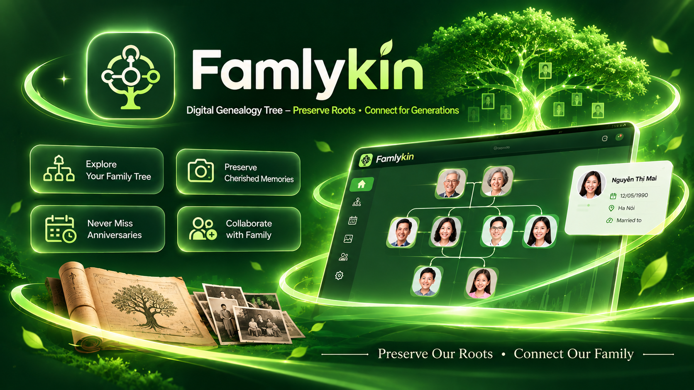

# Famlykin — Digital Family Tree for Vietnamese Families

**[Tiếng Việt](README_VI.md)** • English

<p align="center">
  
</p>

<p align="center">
  <strong>Turn memories, relationships, and family traditions into an easy-to-view easy-to-update, and easy-to-share digital legacy.</strong>
</p>

## What is Famlykin?

Famlykin is a **digital family tree platform** designed for individuals families, and extended clans. Instead of scattered information across paper notebooks, chat messages, or individual memories Famlykin centralizes everything into an intuitive space:

- Visual diagrams showing generations and relationships (parent-child, spouses, adoptive relationships).
- Individual profiles with avatars, biographies, birth dates, and relevant information.
- Records of deceased members including lunar death anniversaries, burial locations, and map coordinates.
- Multiple family trees/branches with collaborative permissions and membership invitations.

## What problems does Famlykin solve?

| User Pain Points | How Famlykin Solves Them |
| --- | --- |
| Paper family trees are hard to preserve, easily lost, or kept by one elderly member | Centralized digital storage with ongoing updates |
| Younger generations struggle to understand roles and relationships in large families | Visual generation-based display with search and kinship calculation |
| Family member information scattered across chat groups Excel files, and photo albums | Unified profile for each member with attached images and biography |
| Easy to forget lunar death anniversaries birthdays, or memorial dates | Lunar anniversary calendar with upcoming event reminders |
| Data updates depend on one administrator | Invite relatives with **VIEWER** or **EDITOR** permissions |
| Difficult to share or print family tree data | Share via invite/link and export to Excel |

## What can you do?

### Explore the Family Tree

- View the family tree as a diagram or condensed directory.
- Filter by paternal/maternal branches and switch between detailed/compact views.
- Select a person as the reference point to quickly understand surrounding relationships.
- Lookup kinship relationships between two members.
- Use flashcards to review names and roles of family members.

### Preserve Memories and Traditions

- Create multiple family trees or clan branches.
- Add, edit, and delete members and their relationships.
- Store avatars, nicknames, biographies, birth dates, and hometowns/addresses.
- Record lunar death anniversaries, burial locations, and link map coordinates.
- Track anniversaries and set reminders.

### Collaborate with Family

- Invite relatives via email or link to join the tree.
- Assign `VIEWER`/`EDITOR` permissions to each collaborator.
- Manage multiple branches in one shared space.
- Real-time synchronization via WebSocket.

### Account and Administration

- Register login with magic link, and account recovery.
- Email/phone verification and rate limiting/Turnstile for sensitive flows.
- Free tier and PRO tier with payments via PayOS/SePay.
- Admin dashboard to track users, trees, members, and subscription plans.

<p align="center">
  
</p>

## Technology

- **Frontend:** React 18, TypeScript, Vite, Tailwind CSS, Lucide React.
- **Backend:** Node.js, Express, TypeScript, Prisma.
- **Database:** PostgreSQL in Docker; Prisma schema ready for deployment environments.
- **Integration:** Firebase/Supabase for authentication/services, PayOS/SePay for payments WebSocket for real-time updates.
- **Deployment:** Docker Compose, Nginx reverse proxy, Docker volume for uploads.

## Project Structure

```text
FamilyTree/
├── frontend/              # React + Vite interface
│   ├── src/components/    # Family tree profiles, sharing, lunar calendar...
│   └── public/            # Images, favicon, and landing page video
├── backend/               # Express API + Prisma
│   ├── prisma/            # Database schema
│   └── src/               # Controllers, routes, services, middleware
├── docker-compose.yml     # PostgreSQL + Backend + Frontend
└── package.json           # Scripts for the entire system
```

## Run with Docker (recommended)

```powershell
# Start PostgreSQL, backend, and frontend
docker compose up -d

# View status and logs
docker compose ps
docker compose logs -f

# Stop the system
docker compose down
```

Default addresses:

- **Web application:** [http://localhost:8088](http://localhost:8088)
- **Backend API:** `http://localhost:5000`
- **PostgreSQL:** `localhost:5433`

## Run locally without Docker

Requirements: Node.js and a running PostgreSQL instance. Then configure `DATABASE_URL` for the backend.

```powershell
# Install dependencies at root backend, and frontend
npm run install:all

# Run backend and frontend simultaneously
npm run dev
```

- **Backend:** `http://localhost:5000`
- **Frontend:** `http://localhost:5173` (or the port shown by Vite)

## Useful Commands

```powershell
npm run build       # Build backend and frontend
npm run seed        # Seed sample data for backend
npm run docker:up   # Start Docker Compose
npm run docker:down # Stop Docker Compose
```

## Project Status

Famlykin is being developed to become the "living family tree" for every family: not just storing names and dates, but helping generations understand each other and preserve their family stories together.