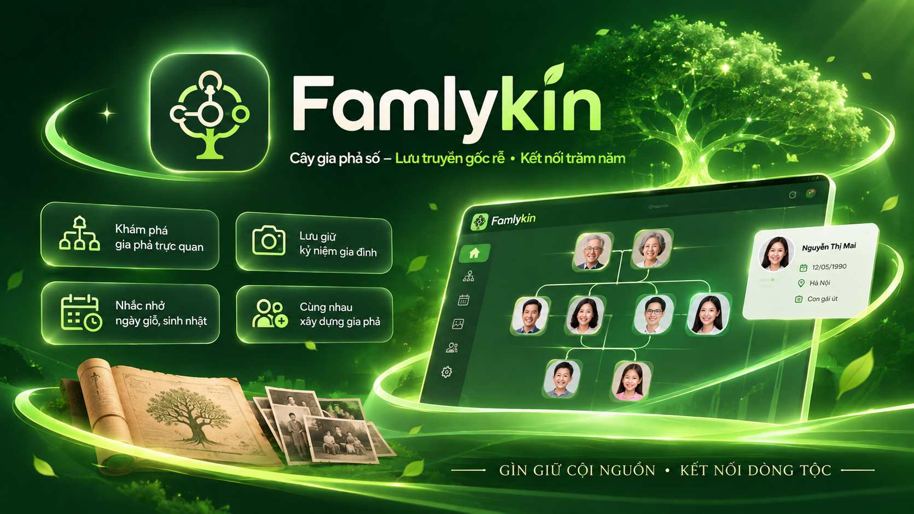

# Famlykin — Cây gia phả số cho gia đình Việt

<p align="center">
  
</p>

<p align="center">
  <strong>Biến ký ức, mối quan hệ và truyền thống gia đình thành một di sản số dễ xem, dễ cập nhật và dễ chia sẻ.</strong>
</p>

## Famlykin là gì?

Famlykin là nền tảng quản lý **cây gia phả số** dành cho cá nhân, gia đình và dòng họ. Thay vì để thông tin người thân nằm rải rác trong sổ giấy, tin nhắn hoặc trí nhớ của từng thành viên, Famlykin tập trung mọi dữ liệu vào một không gian trực quan:

- Sơ đồ các thế hệ và quan hệ cha mẹ, con cái, vợ chồng, con nuôi.
- Hồ sơ từng thành viên với ảnh đại diện, tiểu sử, ngày sinh và thông tin liên quan.
- Thông tin người đã khuất, ngày giỗ âm lịch và địa điểm an táng.
- Nhiều cây/nhánh gia đình, phân quyền cộng tác và lời mời tham gia.

## Famlykin giải quyết nỗi đau nào?

| Nỗi đau của người dùng | Cách Famlykin giải quyết |
| --- | --- |
| Gia phả giấy khó bảo quản, thất lạc hoặc chỉ một người lớn tuổi nắm giữ | Lưu trữ tập trung trên nền tảng số, có thể cập nhật theo thời gian |
| Người trẻ khó hiểu vai vế và mối quan hệ trong đại gia đình | Hiển thị trực quan theo thế hệ, hỗ trợ tìm kiếm và tính quan hệ họ hàng |
| Thông tin người thân bị phân tán ở nhiều nhóm chat, file Excel và album ảnh | Mỗi thành viên có một hồ sơ thống nhất, có thể đính kèm ảnh và tiểu sử |
| Dễ bỏ quên ngày giỗ, sinh nhật hoặc các dịp tưởng nhớ | Lịch giỗ âm lịch và nhắc sự kiện sắp tới |
| Việc bổ sung dữ liệu phụ thuộc vào một người quản lý | Mời người thân tham gia với vai trò **chỉ xem** hoặc **chỉnh sửa** |
| Khó chia sẻ hoặc in lại dữ liệu gia phả | Chia sẻ cây qua lời mời/liên kết và xuất danh sách thành Excel |

## Có thể làm gì?

### Khám phá gia phả

- Xem cây gia đình theo dạng sơ đồ hoặc danh bạ thu gọn.
- Lọc theo nhánh nội/ngoại và chuyển đổi chế độ xem chi tiết/gọn.
- Chọn một người làm điểm nhìn để hiểu nhanh các mối quan hệ xung quanh.
- Tra cứu quan hệ họ hàng giữa hai thành viên.
- Dùng flashcard để ôn nhớ tên và vai vế người thân.

### Lưu giữ ký ức và truyền thống

- Tạo nhiều cây gia đình hoặc nhánh dòng họ.
- Thêm, sửa, xoá thành viên và các mối quan hệ.
- Lưu ảnh đại diện, biệt danh, tiểu sử, ngày sinh, quê quán/địa chỉ.
- Ghi ngày mất âm lịch, nơi an táng và liên kết tọa độ bản đồ.
- Theo dõi lịch giỗ, sinh nhật và thiết lập nhắc lịch.

### Cộng tác cùng gia đình

- Mời người thân qua email hoặc liên kết tham gia cây.
- Phân quyền `VIEWER`/`EDITOR` cho từng cộng tác viên.
- Quản lý nhiều nhánh trong một không gian chung.
- Đồng bộ thay đổi theo thời gian thực qua WebSocket.

### Tài khoản và quản trị

- Đăng ký, đăng nhập, đăng nhập bằng magic link và khôi phục tài khoản.
- Xác thực email/điện thoại và bảo vệ các luồng nhạy cảm bằng rate limit/Turnstile.
- Gói miễn phí và gói PRO với thanh toán qua PayOS/SePay.
- Khu vực quản trị để theo dõi người dùng, cây, thành viên và gói dịch vụ.

<p align="center">
  
</p>

## Công nghệ

- **Frontend:** React 18, TypeScript, Vite, Tailwind CSS, Lucide React.
- **Backend:** Node.js, Express, TypeScript, Prisma.
- **Cơ sở dữ liệu:** PostgreSQL trong Docker; Prisma schema sẵn sàng cho môi trường triển khai.
- **Tích hợp:** Firebase/Supabase cho xác thực/dịch vụ liên quan, PayOS/SePay cho thanh toán, WebSocket cho cập nhật thời gian thực.
- **Triển khai:** Docker Compose, Nginx reverse proxy, lưu trữ upload qua Docker volume.

## Cấu trúc dự án

```text
FamilyTree/
├── frontend/              # Giao diện React + Vite
│   ├── src/components/    # Cây gia phả, hồ sơ, chia sẻ, lịch giỗ...
│   └── public/            # Hình ảnh, favicon và video landing page
├── backend/               # API Express + Prisma
│   ├── prisma/            # Schema cơ sở dữ liệu
│   └── src/               # Controllers, routes, services, middleware
├── docker-compose.yml     # PostgreSQL + Backend + Frontend
└── package.json           # Scripts chạy toàn hệ thống
```

## Chạy bằng Docker (khuyến nghị)

```powershell
# Khởi động PostgreSQL, backend và frontend
docker compose up -d

# Xem trạng thái và log
docker compose ps
docker compose logs -f

# Dừng hệ thống
docker compose down
```

Địa chỉ mặc định:

- **Ứng dụng web:** [http://localhost:8088](http://localhost:8088)
- **Backend API:** `http://localhost:5000`
- **PostgreSQL:** `localhost:5433`

## Chạy local không dùng Docker

Yêu cầu Node.js và một PostgreSQL đang chạy, sau đó cấu hình `DATABASE_URL` cho backend.

```powershell
# Cài dependencies ở root, backend và frontend
npm run install:all

# Chạy backend và frontend song song
npm run dev
```

- **Backend:** `http://localhost:5000`
- **Frontend:** `http://localhost:5173` (hoặc cổng được Vite hiển thị)

## Một số lệnh hữu ích

```powershell
npm run build       # Build backend và frontend
npm run seed        # Nạp dữ liệu mẫu cho backend
npm run docker:up   # Khởi động Docker Compose
npm run docker:down # Dừng Docker Compose
```

## Trạng thái dự án

Famlykin đang được phát triển theo hướng trở thành “cuốn gia phả sống” của mỗi gia đình: không chỉ lưu tên và ngày tháng, mà còn giúp các thế hệ hiểu nhau hơn và cùng gìn giữ câu chuyện dòng họ.
